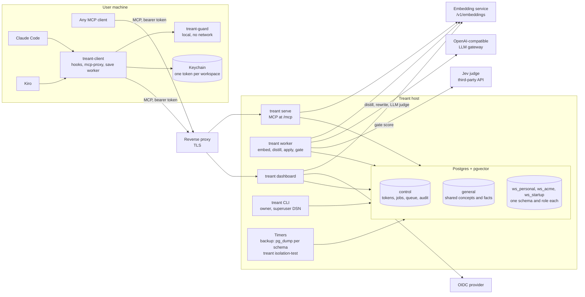
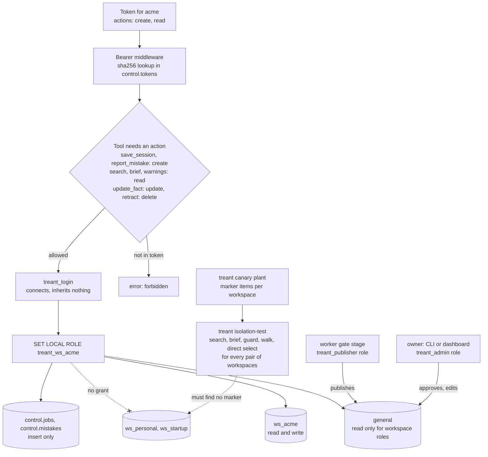
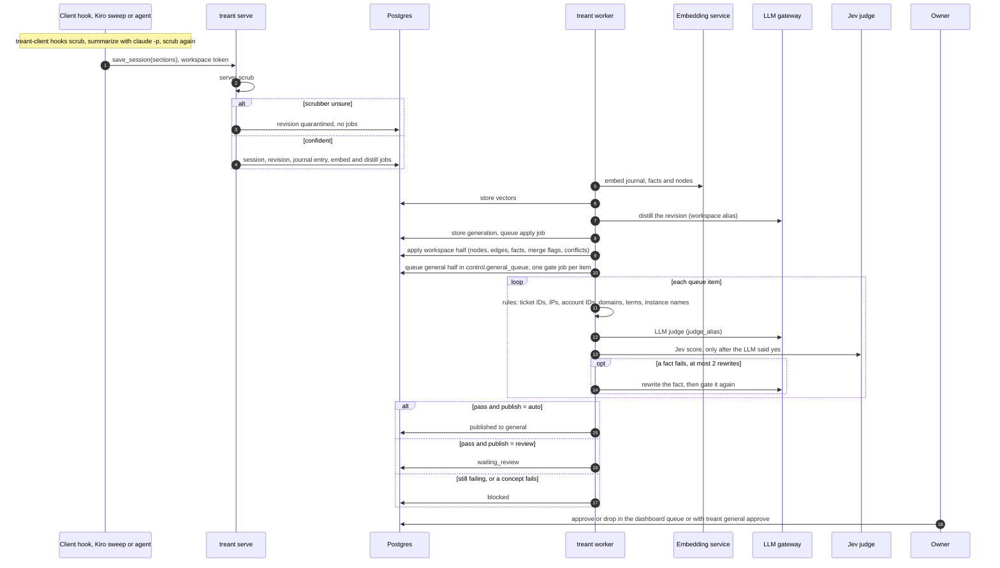
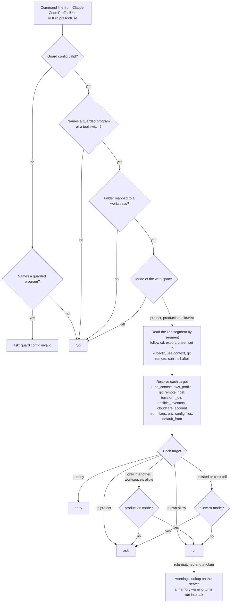

# treant-memory

Long-term memory for AI coding agents, served over MCP and stored in Postgres with pgvector.

Status: source-available, early (0.1.0). The Python package and the CLI are called `treant`.

## What it is

Treant keeps what an agent learns in one session (facts, decisions, lessons, dead ends,
procedures, open threads, warnings) and gives it back in the next one. Memory is split into
**workspaces** (for example `personal`, `acme` for an employer, `startup` for a side business).
Each workspace lives in its own Postgres schema behind its own database role, and an agent
holds a token for exactly one workspace, so work for one client never leaks into another.
Know-how that is safe to share across workspaces is promoted to a common `general` schema, but
only after it passes a gate of rules and two independent judges.

The repository holds three packages:

| Package | Path | What |
|---|---|---|
| `treant` | `src/treant` | MCP server, background worker, owner CLI and dashboard |
| `treant-client` | `client/` | Claude Code and Kiro adapters: session hooks, stdio MCP proxy, save worker |
| `treant-guard` | `guard/` | Local pre-flight guard for risky shell commands (kubectl, aws, terraform, git push, ...) |

## Features

- **Workspace isolation in the database.** One schema `ws_<name>` and one role per workspace;
  the server switches to that role for every query. A canary and isolation test proves that no
  workspace can read another (`treant isolation-test`).
- **Workspace-bound tokens with action scopes** (`create`, `read`, `update`, `delete`). Only a
  SHA-256 of the secret is stored.
- **MCP tools:** `save_session`, `search`, `brief`, `warnings`, `update_fact`, `retract`,
  `report_mistake` (and the deprecated `guard_check`).
- **Hybrid search:** cosine similarity over workspace and `general` vectors plus a one-hop
  graph walk.
- **Scrubbing before storage.** The client and the server both remove secrets, tokens, IP
  addresses, private host names and configured terms. A save the scrubber is not sure about is
  quarantined for the owner instead of stored.
- **Distillation.** A model turns each saved session into graph items: nodes, edges and facts
  for the workspace, and concepts and facts proposed for `general`.
- **The gate on `general`.** Deterministic rules (ticket IDs, IPs, account IDs, configured
  domains and terms, other workspaces' instance names), then an LLM judge, then the Jev judge.
  Failing facts are rewritten at most twice, then blocked. Publishing can be automatic or wait
  for owner review.
- **Owner dashboard** (`treant dashboard`): review queue, quarantine, jobs, workspaces and
  settings, tokens, memory browser with history and restore, duplicates, merges, conflicts, a
  graph view, mistakes, measurements and the audit log. OIDC login (Authelia and Authentik are
  covered by the tests) or a single-owner mode for a trusted network.
- **Guard** (`treant-guard`): decides locally, without a server, whether a shell command acts on
  a target (kube context, AWS profile, git remote host, Terraform folder, ...) that belongs to
  the current workspace, and answers run, ask or deny.

## Design and architecture

The full description is in [docs/architecture.md](docs/architecture.md). The diagrams below
show the main parts.

### System overview



### Workspace isolation



### Save and distillation



### Guard decision



Any denied target makes the whole command `deny`; otherwise any finding makes it `ask`. An
internal error or the 3 second budget running out also asks (fail closed).

## Quickstart

Needs Docker with Compose. Everything listens on loopback only.

```sh
cp .env.example .env          # then set POSTGRES_PASSWORD and TREANT_LOGIN_PASSWORD
docker compose build
docker compose up -d postgres embed            # the first start downloads the embedding model (about 330 MB)
docker compose run --rm admin bootstrap        # one-shot: roles, schemas, grants
docker compose run --rm admin workspace create personal
docker compose run --rm admin canary plant personal
docker compose up -d treant worker
curl http://127.0.0.1:8000/healthz             # ok
docker compose run --rm admin token create personal --label laptop --actions create,read,update,delete
```

The token is printed once and not stored. Connect any MCP client that speaks streamable HTTP
to `http://127.0.0.1:8000/mcp` with the header `Authorization: Bearer <token>`, for example:

```sh
claude mcp add --transport http treant-personal http://127.0.0.1:8000/mcp \
  --header "Authorization: Bearer <token>"
```

For the Claude Code and Kiro hooks (session briefs, automatic saves, the guard) install
`treant-client` instead; see [client/README.md](client/README.md).

`compose.yml` runs `postgres` (`pgvector/pgvector:0.8.6-pg17-bookworm`), `embed` (llama.cpp
server with EmbeddingGemma 300M), `treant` (`serve`), `worker` and a one-shot `admin` service
for the owner CLI (`docker compose run --rm admin <command>`). It is meant for one machine.
For a public host put the server behind a TLS reverse proxy and set `TREANT_ALLOWED_HOSTS`.

### Models: what works without them

| Without | What still works | What does not |
|---|---|---|
| LLM gateway (`TREANT_LITELLM_URL`, `TREANT_LITELLM_KEY_<WS>`) | Saves are stored, embedded and searchable (journal entries); `brief`, `warnings`, the guard. | Distillation into nodes and facts, and therefore promotion to `general`. Distill jobs fail as `model_unavailable` and end up dead after 12 attempts (replay them later with `treant jobs retry --status dead`). To keep a workspace journal-only on purpose, run `treant workspace set <ws> --backend none`. |
| Jev judge (`TREANT_JEV_API_KEY`) | Everything in the workspace, including distillation. | Automatic publishing to `general`. Gate jobs fail as `judge_unavailable` and the items stay `pending`. Promote items yourself with `treant general approve <id>` (or in the dashboard). |

The Jev judge is a third-party service (default endpoint `https://api.typesafe.ai`, override
with `TREANT_JEV_URL` and `TREANT_JEV_MODEL`); its key is required for automatic publishing to
`general`. A workspace with `--backend none` never sends anything to any model: its general
items are held as `blocked` (reason `judge:none`) for the owner.

The LLM gateway is any OpenAI-compatible chat endpoint (LiteLLM was used in development). The
worker posts to `<TREANT_LITELLM_URL>/chat/completions` with the workspace's `alias` (default
`default`) as the model, and the workspace's own key `TREANT_LITELLM_KEY_<WORKSPACE>`, so each
workspace can have its own model and budget.

### Embeddings

The supported embedding model is **EmbeddingGemma 300M (768 dimensions)**. The vector columns
are declared `vector(768)` and the embedder sends EmbeddingGemma's query and document prompt
prefixes, so other models or dimensions do not work without code changes. Choose the
embedding service before the first save. Any service that serves this model behind an
OpenAI-compatible `/v1/embeddings` works; the quickstart uses llama.cpp with
`ggml-org/embeddinggemma-300M-GGUF`.

## Production deployment

To run Treant in production (Postgres + pgvector, embedding service, LLM gateway, Jev judge,
OIDC dashboard, backups and the nightly isolation test), follow
[docs/deploy.md](docs/deploy.md). It ships a ready Compose stack and example env files in
`deploy/`.

## Configuration

Server (`treant serve`, `treant worker`, `treant dashboard`, owner CLI):

| Variable | Used by | Default |
|---|---|---|
| `TREANT_ADMIN_DATABASE_URL` | `bootstrap`, `upgrade`, `workspace create`, other owner commands (superuser DSN) | required there |
| `TREANT_LOGIN_PASSWORD` | `bootstrap` (password of the `<prefix>_login` role) | required there |
| `TREANT_DATABASE_URL` | everything else (login role DSN) | required |
| `TREANT_EMBED_URL` | `serve`, `worker`, `dashboard`, `canary plant`, `isolation-test` | required |
| `TREANT_EMBED_MODEL` | model name sent to the embedding service | `embeddinggemma-300m` |
| `TREANT_EMBED_DIMS` | must stay `768` (see Embeddings) | `768` |
| `TREANT_ROLE_PREFIX` | prefix of every database role | `treant` |
| `TREANT_BIND` | `serve` listen address | `127.0.0.1:8000` |
| `TREANT_ALLOWED_HOSTS` | comma-separated public host names; turns on Host and Origin checks | off |
| `TREANT_LITELLM_URL`, `TREANT_LITELLM_KEY_<WS>` | worker: distillation, rewrites, LLM judge | unset |
| `TREANT_JEV_API_KEY`, `TREANT_JEV_URL`, `TREANT_JEV_MODEL` | worker: the Jev judge | key unset |

Dashboard (`treant dashboard`):

| Variable | Meaning | Default |
|---|---|---|
| `TREANT_DASHBOARD_URL` | public `https://` origin, no path; the only accepted Host | required |
| `TREANT_DASHBOARD_SESSION_SECRET` | cookie signing secret, at least 32 characters | required |
| `TREANT_DASHBOARD_OWNERS` | comma-separated usernames allowed in | required |
| `TREANT_DASHBOARD_AUTH` | `oidc`, or `none` (no login, one owner; trusted network only) | `oidc` |
| `TREANT_OIDC_ISSUER`, `TREANT_OIDC_CLIENT_SECRET` | OIDC provider (with `oidc`) | required with `oidc` |
| `TREANT_OIDC_CLIENT_ID`, `TREANT_DASHBOARD_GROUP` | client id; group the user must be in | `treant`, `treant` |
| `TREANT_DASHBOARD_BIND`, `TREANT_DASHBOARD_REAUTH_S` | listen address; age of a login for sensitive actions | `0.0.0.0:8001`, `300` |

Per-workspace settings (`treant workspace set <ws> ...`): `--backend litellm|none`, `--alias`,
`--judge-alias`, `--publish auto|review`, and the gate's deny lists `--domain`,
`--ticket-prefix`, `--term` (terms also drive the server scrubber).

## CLI

```
treant bootstrap | upgrade
treant workspace create|list|show|archive <name>
treant workspace set <name> [--backend ...] [--publish ...] [--domain ...] [--term ...] [--reset]
treant workspace purge <name> --confirm <name>      # archived workspaces only
treant token create <workspace> --label <l> --actions create,read[,update,delete]
treant token list <workspace> | revoke <id>
treant canary plant <workspace> [--if-missing] | list
treant isolation-test                               # exit 0 clean, 1 on any fault
treant general list|show|approve|drop ...           # the queue to general
treant quarantine list|show|release|drop ...
treant jobs list [--status dead] | retry ...
treant merges list <ws> | conflicts list <ws> | duplicates <ws|general>
treant distill backfill <ws> [--dry-run]
treant serve | worker | dashboard
treant target add|list|remove ...                   # deprecated
```

`token create` prints the token once; it is not stored. `workspace archive` revokes the
workspace's tokens. Owner actions are recorded in `control.audit` (actor `cli`, or
`dashboard:<user>`).

The `target` commands and the `guard_check` MCP tool are deprecated and kept for older
clients: the client guard decides locally from its own config and asks the server only for
`warnings`.

## Clients and guard

- [client/README.md](client/README.md): `treant-client` wires Claude Code and Kiro to Treant
  (session start brief, automatic save at session end, stdio MCP proxy that picks the token from
  the folder's workspace). It currently targets macOS (Keychain, launchd).
- [guard/README.md](guard/README.md): `treant-guard` configuration, rule pack, modes and known
  gaps. It runs on its own, without a Treant server.

## Tests

```sh
docker compose -f compose.test.yml up -d    # Postgres 17 + pgvector on 127.0.0.1:55432
uv sync && uv run ruff check && uv run pytest -q
uv sync --directory client && uv run --directory client ruff check && uv run --directory client pytest -q
uv sync --directory guard && uv run --directory guard ruff check && uv run --directory guard pytest -q
```

The database tests skip when that Postgres is not reachable. Each run creates its own database
and role prefix and drops them afterwards. CI runs all three suites with the database.

See [CONTRIBUTING.md](CONTRIBUTING.md) and [SECURITY.md](SECURITY.md).

## Licence

treant-memory is **source-available**, not free for every use. Every copy must keep the licence
and the `Required Notice` line that names the source.

| Who | Terms |
|---|---|
| Personal and other noncommercial use (including charities, schools, public research) | Free, under the [PolyForm Noncommercial License 1.0.0](LICENSE) |
| Companies with fewer than 5 people (owners, employees and contractors together) | Free, also commercially, under the [Small Company Grant](SMALL-COMPANY-GRANT.md) |
| Larger companies | Commercial licence from the licensor |

Contributions are accepted under the [Contributor License Agreement](CLA.md).

To ask for a commercial licence, open an issue titled "Commercial licence" in
https://github.com/ashkmb/treant-memory or contact Ashkan Kamyab through https://ashkmb.com.
