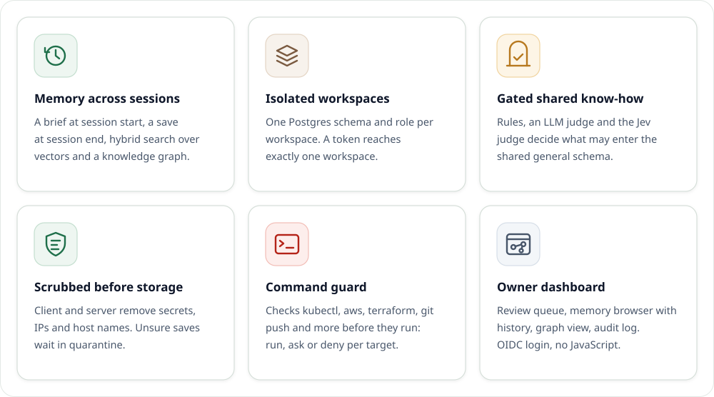
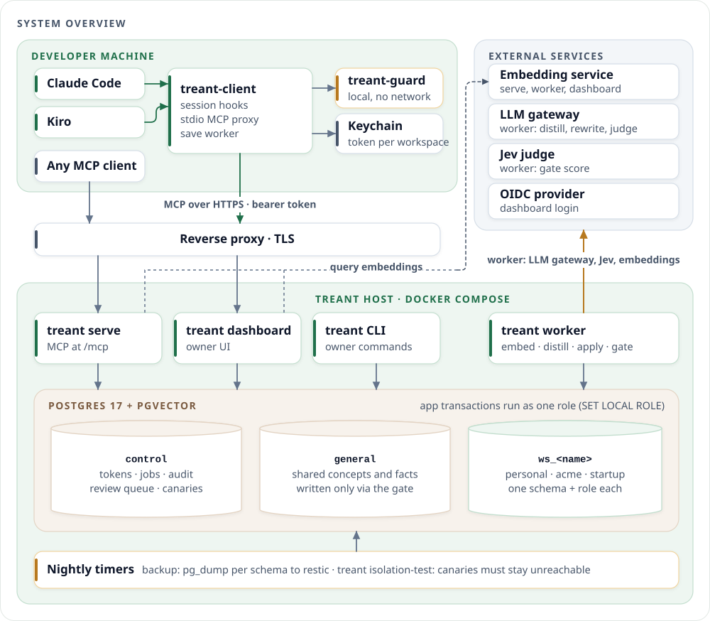
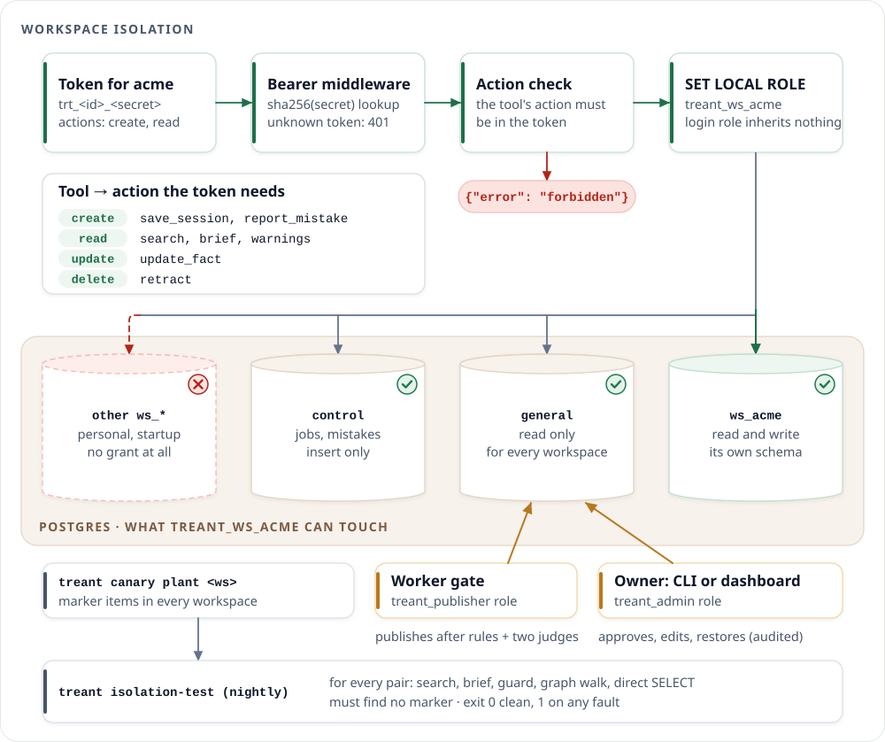
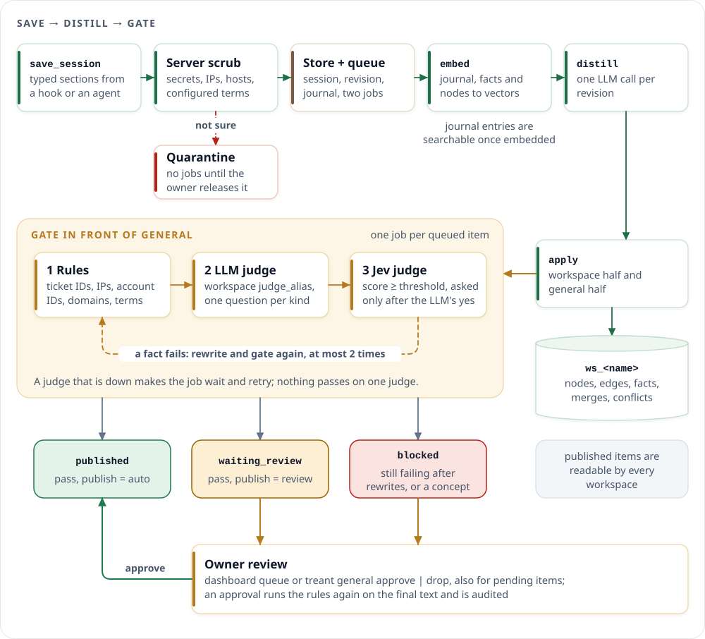
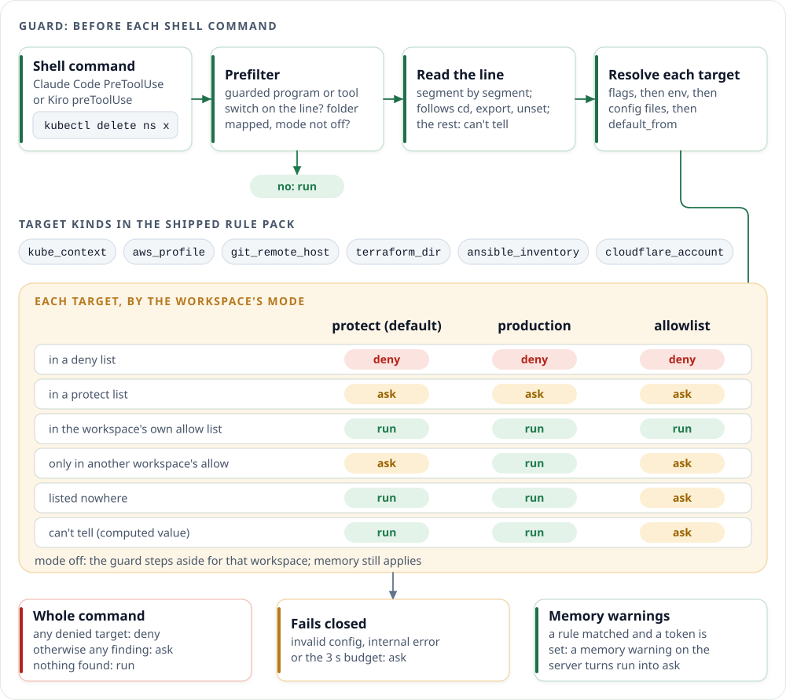
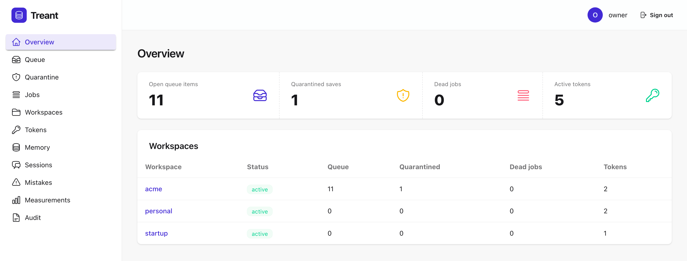
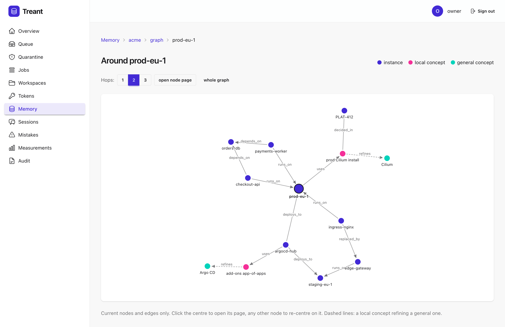
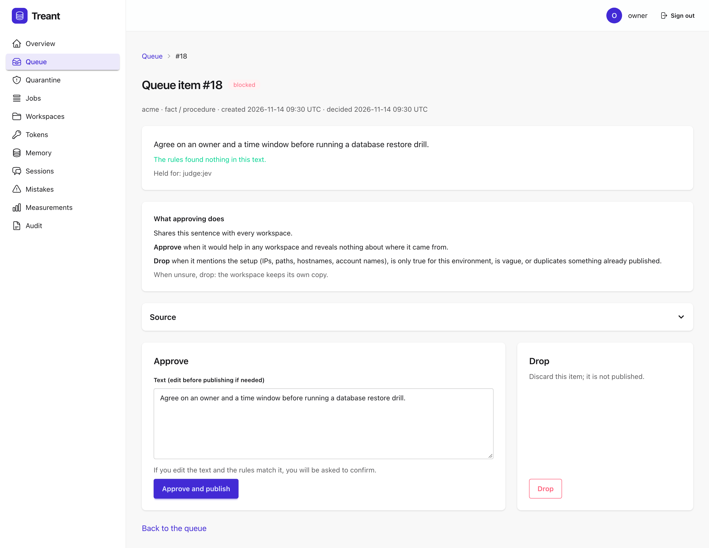
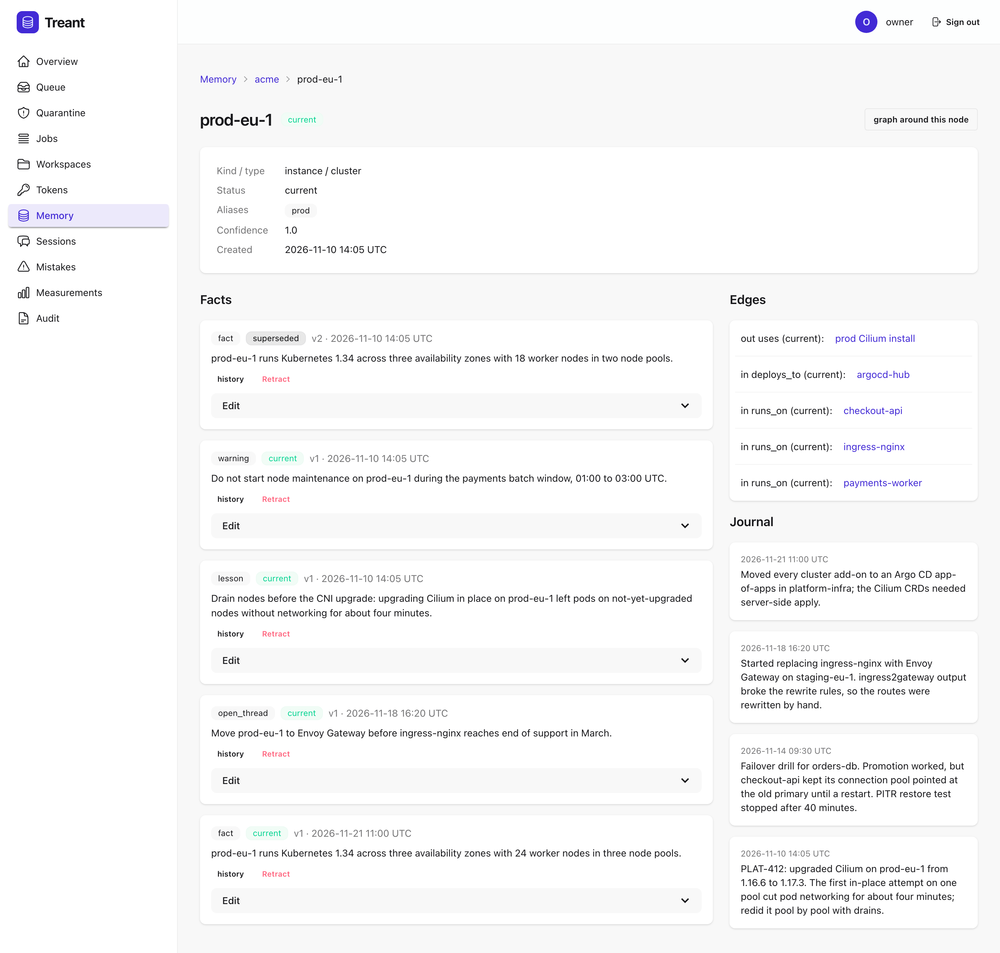

<p align="center">
  <picture>
    <source media="(prefers-color-scheme: dark)" srcset="docs/assets/banner-dark.svg">
    
  </picture>
</p>

<div align="center">

[](https://github.com/ashkmb/treant-memory/actions/workflows/ci.yml)
[](https://github.com/ashkmb/treant-memory/releases)
[](#licence)
[](https://www.python.org/)
[](https://github.com/pgvector/pgvector)
[](https://modelcontextprotocol.io/)

[Quick start](#quick-start) · [Features](#features) · [How it works](#how-it-works) · [Screenshots](#screenshots) · [Deploy](#production-deployment) · [Licence](#licence)

</div>

---

## Overview

Treant is a self-hosted MCP server that gives Claude Code, Kiro and any other MCP client a memory
that outlives the session. What an agent learns is scrubbed, saved and distilled into a knowledge
graph that the next session can search.

- **Remembers across sessions:** a brief at session start and hybrid search over vectors and graph,
  so agents stop re-learning the same things.
- **Keeps contexts apart:** each workspace (`personal`, `acme`, `startup`) is its own Postgres schema
  and role, and a token reaches exactly one.
- **Shares only what is safe:** know-how reaches the common `general` schema only through a gate of
  rules and two independent judges.

Status: source-available, early (0.1.0). The Python package and the CLI are called `treant`.

## Why Treant

Seen from a coding agent's side of the terminal, four things go wrong without it:

- **Every session starts from zero.** The agent rediscovers the repository layout, the build quirk
  and the approach it already ruled out last week, and spends tokens doing it. Treant hands it a
  brief at session start (warnings, open threads, what memory holds about the repository) and a
  hybrid search over vectors and a graph of everything saved before.
- **Context bleeds between clients.** When one machine serves an employer, a client and your own
  projects, a single memory store will surface one client's host names in another client's session.
  In Treant a token reaches one workspace, and the database role behind it has no grant on any
  other workspace's schema. An isolation test (nightly in the production setup) tries to cross
  every pair of workspaces and fails loudly if it can.
- **Shared know-how and private details look alike.** A lesson about a library is useful
  everywhere; the name of a production cluster is not. Each session is distilled into a workspace
  half and a general half, and the general half reaches the shared schema only after rules (ticket
  IDs, IPs, account IDs, your domains and terms, every workspace's instance names), an LLM judge and
  the Jev judge all agree.
- **Agents run commands against the wrong target.** An agent working in one project can still
  `kubectl delete` against whatever context is current. `treant-guard` reads each shell command
  before it runs, resolves the kube context, AWS profile, git host, Terraform folder, Ansible
  inventory or Cloudflare account it acts on, and asks or refuses when that target is protected or
  belongs to another workspace. It runs locally, without a server.

## Features

<p align="center">
  <picture>
    <source media="(prefers-color-scheme: dark)" srcset="docs/assets/features-dark.svg">
    
  </picture>
</p>

### Memory that carries over

- **MCP tools:** `save_session`, `search`, `brief`, `warnings`, `update_fact`, `retract`,
  `report_mistake` (plus the deprecated `guard_check`).
- **Typed saves:** journal, facts, decisions, lessons, dead ends, procedures, changes, open threads,
  preferences, warnings and client memory.
- **Hybrid search:** cosine similarity over the workspace's and `general`'s vectors, plus facts
  reached by a one-hop graph walk from the matched nodes.
- **Distillation:** a model turns each saved session into nodes, edges and facts. Near-duplicate
  names are flagged for a merge, superseded facts are recorded as conflicts, and every change keeps
  its history so it can be restored.

### Workspaces isolated by the database

- One schema `ws_<name>` and one role per workspace; the server runs every transaction under
  `SET LOCAL ROLE`, and search drops any hit whose schema is not the token's.
- Tokens are bound to one workspace and carry action scopes (`create`, `read`, `update`,
  `delete`). Only a SHA-256 of the secret is stored.
- `treant canary plant` and `treant isolation-test` prove on a schedule that no workspace can
  reach another through search, brief, guard, the graph walk or a direct `SELECT`.

### A gate in front of shared knowledge

- Deterministic rules first, then an LLM judge, then the Jev judge. A failing fact is rewritten at
  most twice, then blocked.
- Publishing is automatic or waits for owner review, per workspace. A judge that is down makes the
  job wait; nothing passes on one judge.

### Scrubbed before storage

- The client and the server both remove secrets, tokens, IP addresses, private host names and
  configured terms. A save the scrubber is not sure about is quarantined for the owner instead of
  stored.

### A guard for risky commands

- The shipped rule pack covers `kubectl`, `helm`, `aws`, `terraform`, `terragrunt`, `git push`,
  `ansible-playbook` and `wrangler`; add your own rules in TOML.
- Modes `protect` (default), `production`, `allowlist` and `off`, per workspace. Fails closed on an
  invalid config, an internal error or the 3 second budget.

### Owner dashboard

- Review queue, quarantine, jobs, workspaces and settings, tokens, a memory browser with history
  and restore, duplicates, merges, conflicts, a graph view, mistakes, measurements and the audit
  log.
- OIDC login (Authelia and Authentik are covered by the tests) with re-authentication for sensitive
  actions, or a single-owner mode for a trusted network. Server-rendered, no JavaScript.

## How it works

The full description is in [docs/architecture.md](docs/architecture.md).

### System overview

<picture>
  <source media="(prefers-color-scheme: dark)" srcset="docs/assets/architecture-dark.svg">
  
</picture>

Agents reach `treant serve` over MCP (streamable HTTP at `/mcp`) with a bearer token, either
directly or through `treant-client`, which adds session hooks, a stdio MCP proxy that picks the
token for the current folder, and a background save worker. The worker is the only process that
calls the LLM gateway and the Jev judge; the server and the dashboard use only the embedding
service, to embed search queries. Everything lives in one
Postgres database with a `control` schema, the shared `general` schema and one schema per
workspace.

### Workspace isolation

<picture>
  <source media="(prefers-color-scheme: dark)" srcset="docs/assets/isolation-dark.svg">
  
</picture>

A token maps to one workspace and a set of actions. The application connects as a login role that
inherits nothing and switches to the workspace's role for each transaction, so even a bug that asks
for another workspace's schema gets a permission error. Only the gate (as the publisher role) and
the owner (as the admin role) write to `general`. Canary items in every workspace and a nightly
isolation test check every pair of workspaces.

### Save, distillation and the gate

<picture>
  <source media="(prefers-color-scheme: dark)" srcset="docs/assets/pipeline-dark.svg">
  
</picture>

A save is scrubbed, stored as a session revision and a journal entry, and queued. The worker embeds
it (from then on the journal entry is searchable), then distills it with one model call into a workspace half
(applied straight into the workspace graph) and a general half (queued, one gate job per item).
Items that pass are published, or wait for review when the workspace is set to `review`; the owner
decides on everything else in the dashboard or with `treant general approve|drop`.

### Guard decision

<picture>
  <source media="(prefers-color-scheme: dark)" srcset="docs/assets/guard-dark.svg">
  
</picture>

The guard runs in the Claude Code `PreToolUse` or Kiro `preToolUse` hook. It follows `cd`,
`export` and similar state changes on the same line, resolves each target from flags, environment,
config files or a `default_from` command, and compares it with the workspace's lists. Any denied
target makes the whole command `deny`, any other finding makes it `ask`. When a rule matched and the
workspace has a token, a memory warning on the server can also turn a run into an ask. The rule
language, modes and known gaps are in [guard/README.md](guard/README.md).

## Screenshots

<table>
  <tr>
    <td width="50%"></td>
    <td width="50%"></td>
  </tr>
  <tr>
    <td align="center"><sub><b>Overview:</b> queue, quarantine, dead jobs and tokens per workspace</sub></td>
    <td align="center"><sub><b>Graph view:</b> nodes and edges, rendered on the server as SVG</sub></td>
  </tr>
  <tr>
    <td width="50%"></td>
    <td width="50%"></td>
  </tr>
  <tr>
    <td align="center"><sub><b>Review queue:</b> an item headed for <code>general</code> and why it was held; approve (edited if needed) or drop</sub></td>
    <td align="center"><sub><b>Node:</b> facts with their history, edges and journal entries</sub></td>
  </tr>
</table>

## Quick start

Needs Docker with Compose. Everything listens on loopback only.

```sh
git clone https://github.com/ashkmb/treant-memory.git && cd treant-memory
cp .env.example .env          # then set POSTGRES_PASSWORD and TREANT_LOGIN_PASSWORD
docker compose up -d postgres embed            # the first start downloads the embedding model (about 330 MB)
docker compose run --rm admin bootstrap        # one-shot: roles, schemas, grants
docker compose run --rm admin workspace create personal
docker compose run --rm admin canary plant personal
docker compose up -d treant worker
curl http://127.0.0.1:8000/healthz             # ok
docker compose run --rm admin token create personal --label laptop --actions create,read,update,delete
```

The token is printed once and not stored.

Compose pulls the published image `ghcr.io/ashkmb/treant-memory:0.1.0` (linux/amd64 and
linux/arm64). To run your own changes instead, run `docker compose build` first: it builds the
same tag from your checkout. `scripts/quickstart-smoke.sh` runs all of the above plus a save and
a search over MCP; CI runs it on every push.

`compose.yml` runs `postgres` (`pgvector/pgvector:0.8.6-pg17-bookworm`), `embed` (llama.cpp
server with EmbeddingGemma 300M), `treant` (`serve`), `worker` and a one-shot `admin` service
for the owner CLI (`docker compose run --rm admin <command>`). It is meant for one machine.
For a public host put the server behind a TLS reverse proxy and set `TREANT_ALLOWED_HOSTS`.

### Models: what works without them

The quickstart runs without any chat model. Add them in `.env` when you want distillation and
promotion to `general`.

| Without | What still works | What does not |
|---|---|---|
| LLM gateway (`TREANT_LITELLM_URL`, `TREANT_LITELLM_KEY_<WS>`) | Saves are stored, embedded and searchable (journal entries); the guard. `brief` and `warnings` answer, but stay nearly empty: they are built from distilled facts. | Distillation into nodes and facts, and therefore promotion to `general`. Distill jobs fail as `model_unavailable` and end up dead after 12 attempts (replay them later with `treant jobs retry --status dead`). To keep a workspace journal-only on purpose, run `treant workspace set <ws> --backend none`. |
| Jev judge (`TREANT_JEV=off`, the quickstart default) | Everything in the workspace, including distillation and the LLM judge. Items that pass the rules and the LLM judge wait in the review queue. | Automatic publishing to `general`. Approve items yourself with `treant general approve <id>` (or in the dashboard). |

The LLM gateway is any OpenAI-compatible chat endpoint (LiteLLM was used in development). The
worker posts to `<TREANT_LITELLM_URL>/chat/completions` with the workspace's `alias` (default
`default`) as the model, and the workspace's own key `TREANT_LITELLM_KEY_<WORKSPACE>`, so each
workspace can have its own model and budget.

The Jev judge is a third-party service (default endpoint `https://api.typesafe.ai`, override
with `TREANT_JEV_URL` and `TREANT_JEV_MODEL`); its key is required for automatic publishing to
`general`. `TREANT_JEV=off` turns it off: Jev is never called, and nothing is published without
your approval, whatever the workspace's publish mode. The quickstart starts with Jev off; set
`TREANT_JEV=on` and `TREANT_JEV_API_KEY` in `.env` to turn it on. A workspace with `--backend none` never sends anything to any model: its general
items are held as `blocked` (reason `judge:none`) for the owner.

## Connect Claude Code or Kiro

**Any MCP client.** Connect a client that speaks streamable HTTP to `http://127.0.0.1:8000/mcp`
with the header `Authorization: Bearer <token>`. For Claude Code:

```sh
claude mcp add --transport http treant-personal http://127.0.0.1:8000/mcp \
  --header "Authorization: Bearer <token>"
```

**With the hooks (macOS).** `treant-client` adds a brief at session start, an automatic save at
session end, a stdio MCP proxy that picks the token from the folder's workspace, and the command
guard, for Claude Code and Kiro:

```sh
uv tool install ./client          # puts treant-client on PATH (pulls in ./guard)
treant-client token set personal  # prompts; stored in the macOS Keychain
treant-client install --dry-run   # review the diffs
treant-client install
```

Set `url` (and `kiro_agent` for Kiro) in `~/.config/treant/config.toml`, and map your folders to
workspaces under `[workspaces]` in `~/.config/treant/guard.toml`.
[client/README.md](client/README.md) has the details, including `uninstall`;
[guard/README.md](guard/README.md) covers the guard's config, modes and rules.

## Production deployment

To run Treant in production (Postgres + pgvector, embedding service, LLM gateway, Jev judge,
OIDC dashboard, backups and the nightly isolation test), follow
[docs/deploy.md](docs/deploy.md). It ships a ready Compose stack, example env files, systemd
timers and a Caddy example in `deploy/`.

<details>
<summary><b>Configuration</b></summary>

<br>

Server (`treant serve`, `treant worker`, `treant dashboard`, owner CLI):

| Variable | Used by | Default |
|---|---|---|
| `TREANT_ADMIN_DATABASE_URL` | `bootstrap`, `upgrade`, `workspace create`, other owner commands (superuser DSN) | required there |
| `TREANT_LOGIN_PASSWORD` | `bootstrap` (password of the `<prefix>_login` role) | required there |
| `TREANT_DATABASE_URL` | everything else (login role DSN) | required |
| `TREANT_EMBED_URL` | `serve`, `worker`, `dashboard`, `canary plant`, `isolation-test` | required |
| `TREANT_EMBED_MODEL` | model name sent to the embedding service | `embeddinggemma-300m` |
| `TREANT_EMBED_DIMS` | must stay `768` (see Requirements and limitations) | `768` |
| `TREANT_ROLE_PREFIX` | prefix of every database role | `treant` |
| `TREANT_BIND` | `serve` listen address | `127.0.0.1:8000` |
| `TREANT_ALLOWED_HOSTS` | comma-separated public host names; turns on Host and Origin checks | off |
| `TREANT_LITELLM_URL`, `TREANT_LITELLM_KEY_<WS>` | worker: distillation, rewrites, LLM judge | unset |
| `TREANT_JEV` | worker: `on` or `off`; off never calls Jev and sends every pass to review | `on` (`off` in the quickstart) |
| `TREANT_JEV_API_KEY`, `TREANT_JEV_URL`, `TREANT_JEV_MODEL` | worker: the Jev judge | key unset |

Dashboard (`treant dashboard`):

| Variable | Meaning | Default |
|---|---|---|
| `TREANT_DASHBOARD_URL` | public `https://` origin, no path; the only accepted Host | required |
| `TREANT_DASHBOARD_SESSION_SECRET` | cookie signing secret, at least 32 characters | required |
| `TREANT_DASHBOARD_OWNERS` | comma-separated usernames allowed in | required |
| `TREANT_DASHBOARD_AUTH` | `oidc`, or `none` (no login, one owner; trusted network only) | `oidc` |
| `TREANT_OIDC_ISSUER`, `TREANT_OIDC_CLIENT_SECRET` | OIDC provider (with `oidc`) | required with `oidc` |
| `TREANT_OIDC_CLIENT_ID`, `TREANT_DASHBOARD_GROUP` | client id; group the user must be in | `treant`, `treant` |
| `TREANT_DASHBOARD_BIND`, `TREANT_DASHBOARD_REAUTH_S` | listen address; age of a login for sensitive actions | `0.0.0.0:8001`, `300` |

Per-workspace settings (`treant workspace set <ws> ...`): `--backend litellm|none`, `--alias`,
`--judge-alias`, `--publish auto|review`, and the gate's deny lists `--domain`,
`--ticket-prefix`, `--term` (terms also drive the server scrubber).

</details>

<details>
<summary><b>CLI</b></summary>

<br>

```
treant bootstrap | upgrade
treant workspace create|list|show|archive <name>
treant workspace set <name> [--backend ...] [--publish ...] [--domain ...] [--term ...] [--reset]
treant workspace purge <name> --confirm <name>      # archived workspaces only
treant token create <workspace> --label <l> --actions create,read[,update,delete]
treant token list <workspace> | revoke <id>
treant canary plant <workspace> [--if-missing] | list
treant isolation-test                               # exit 0 clean, 1 on any fault
treant general list|show|approve|drop ...           # the queue to general
treant quarantine list|show|release|drop ...
treant jobs list [--status dead] | retry ...
treant merges list <ws> | conflicts list <ws> | duplicates <ws|general>
treant distill backfill <ws> [--dry-run]
treant serve | worker | dashboard
treant target add|list|remove ...                   # deprecated
```

`token create` prints the token once; it is not stored. `workspace archive` revokes the
workspace's tokens. Owner actions are recorded in `control.audit` (actor `cli`, or
`dashboard:<user>`).

The `target` commands and the `guard_check` MCP tool are deprecated and kept for older
clients: the client guard decides locally from its own config and asks the server only for
`warnings`.

</details>

## Requirements and limitations

- **Server:** Docker with Compose for the quickstart. The production guide targets Linux with Docker
  Engine and the Compose plugin v2.24 or newer, and about 2 GB of RAM with the bundled embedder. No
  image is published to a registry; you build it from this repository.
- **Python 3.12+** for `treant` and `treant-client` (`treant-guard` needs 3.11+).
- **Postgres 17 with pgvector 0.8 or newer.** No other extension is needed.
- **One embedding model.** The supported model is **EmbeddingGemma 300M (768 dimensions)**. The
  vector columns are declared `vector(768)` and the embedder sends EmbeddingGemma's query and
  document prompt prefixes, so other models or dimensions do not work without code changes. There
  is no re-embed command: choose the embedding service before the first save. Any service that
  serves this model behind an OpenAI-compatible `/v1/embeddings` works; the quickstart uses
  llama.cpp with `ggml-org/embeddinggemma-300M-GGUF`.
- **Jev for automatic promotion.** With `TREANT_JEV=off` (or without a Jev key) nothing reaches
  `general` unless you approve it. The default Jev endpoint is a third-party internet service, so
  with Jev on, text that passed the rules and the LLM judge leaves your network; decide whether
  that is acceptable for your workspaces.
- **`treant-client` is macOS only today.** It keeps tokens in the macOS Keychain and runs the Kiro
  sweep as a launchd job. On other systems, connect your MCP client to the server directly (no
  automatic brief, save or guard hook).
- **The guard catches an agent's mistakes, not an adversary.** It reads only the command line it is
  given; aliases, scripts, `ssh` and deliberate obfuscation are out of its sight. In `protect` mode
  a target it cannot read runs; use `allowlist` mode where that is not enough. The full list is under
  "Known gaps" in [guard/README.md](guard/README.md).

## Project structure

```
treant-memory/
├── src/treant/        MCP server, worker, owner CLI and dashboard (package `treant`)
│   ├── dashboard/     owner web UI (Starlette, server-rendered)
│   └── sql/           schema for control, general and workspaces
├── client/            treant-client: Claude Code and Kiro adapters
├── guard/             treant-guard: local command guard and its rule pack
├── deploy/            production Compose stack, env files, scripts, systemd timers, Caddy
├── docs/              architecture.md, deploy.md, images
├── tests/             server test suite
├── compose.yml        quickstart stack (loopback only)
└── compose.test.yml   Postgres + pgvector for the tests
```

## Contributing and security

```sh
docker compose -f compose.test.yml up -d    # Postgres 17 + pgvector on 127.0.0.1:55432
uv sync && uv run ruff check && uv run pytest -q
uv sync --directory client && uv run --directory client ruff check && uv run --directory client pytest -q
uv sync --directory guard && uv run --directory guard ruff check && uv run --directory guard pytest -q
```

The database tests skip when that Postgres is not reachable. Each run creates its own database
and role prefix and drops them afterwards. CI runs all three suites with the database.

Issues are welcome. Pull requests open once the contributor agreement is final; see
[CONTRIBUTING.md](CONTRIBUTING.md). Report vulnerabilities
privately as described in [SECURITY.md](SECURITY.md), not in public issues.

## Licence

treant-memory is **source-available**, not free for every use. Every copy must keep the licence
and the `Required Notice` line that names the source.

| Who | Terms |
|---|---|
| Personal and other noncommercial use (including charities, schools, public research) | Free, under the [PolyForm Noncommercial License 1.0.0](LICENSE) |
| Companies with fewer than 5 people (owners, employees and contractors together) | Free, also commercially, under the [Small Company Grant](SMALL-COMPANY-GRANT.md) |
| Larger companies | Commercial licence from the licensor |

Contributions will be accepted under the [Contributor License Agreement](CLA.md) (draft, pending
legal review; pull requests are not open yet).

To ask for a commercial licence, open a
[Commercial licence issue](https://github.com/ashkmb/treant-memory/issues/new?template=commercial-licence.yml)
or contact Ashkan Kamyab through https://ashkmb.com.
