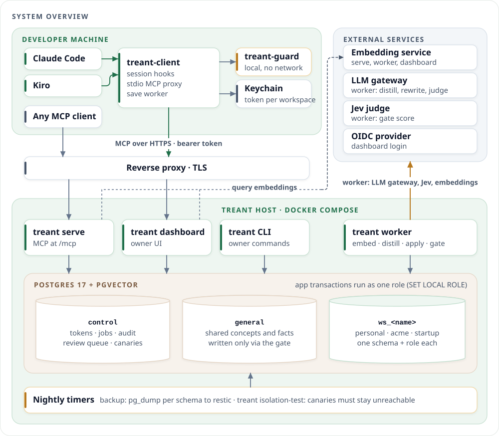
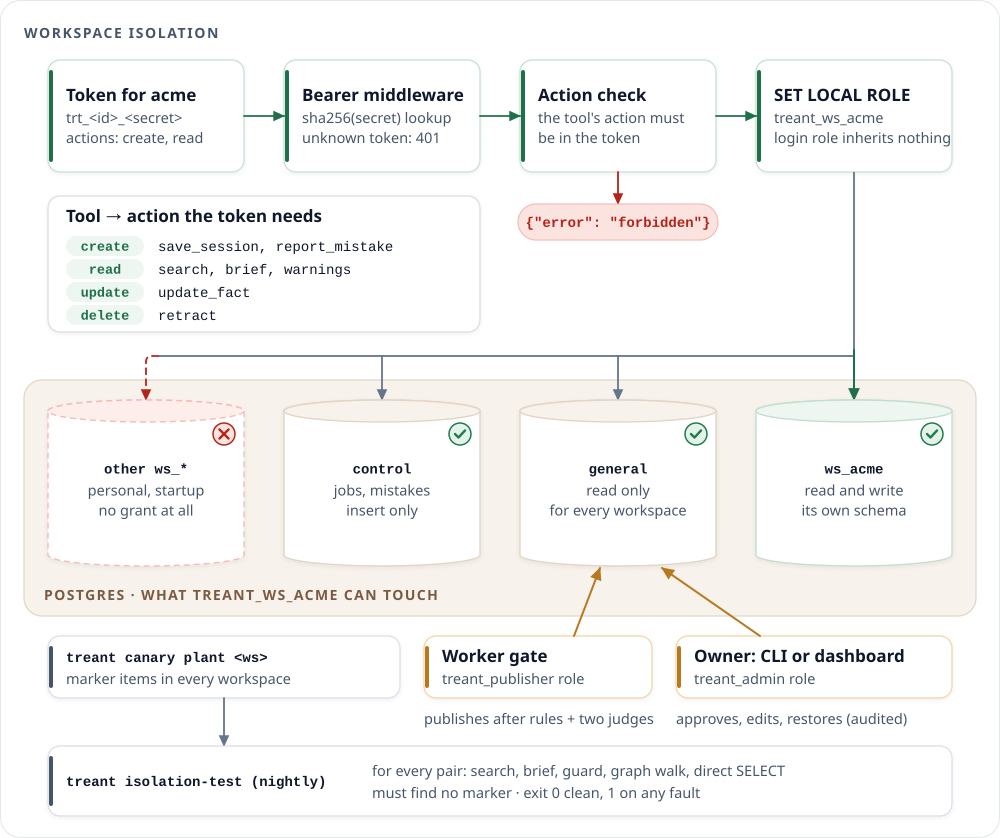
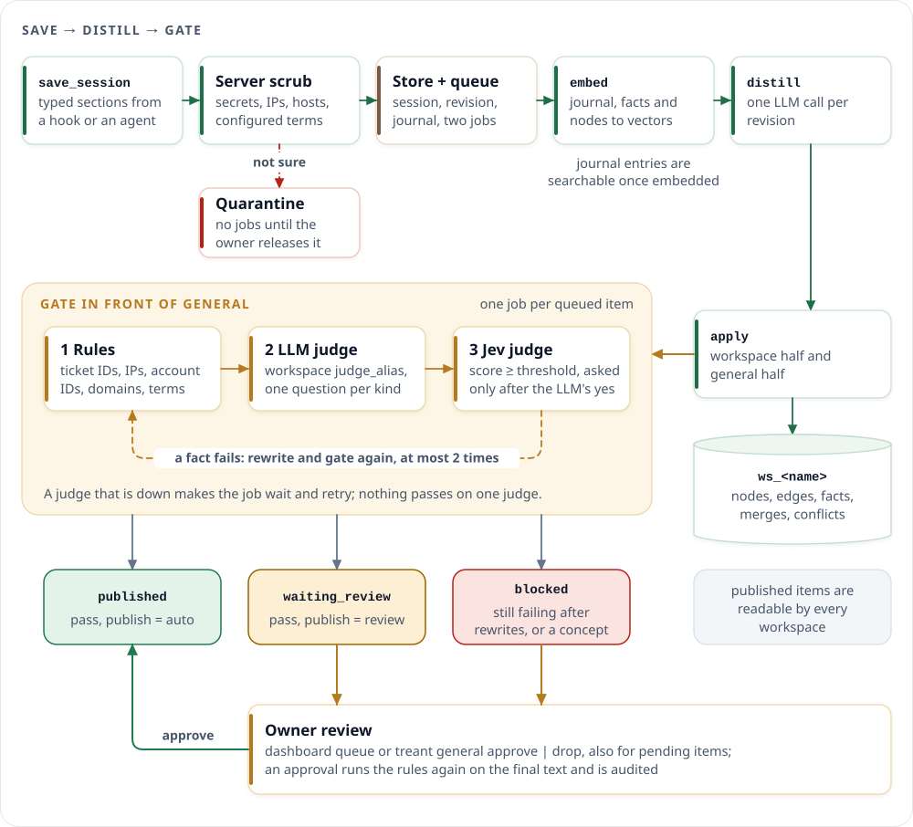
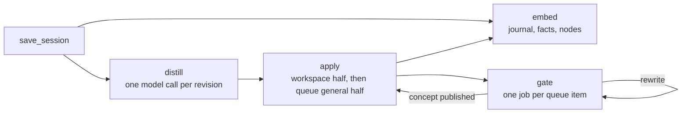
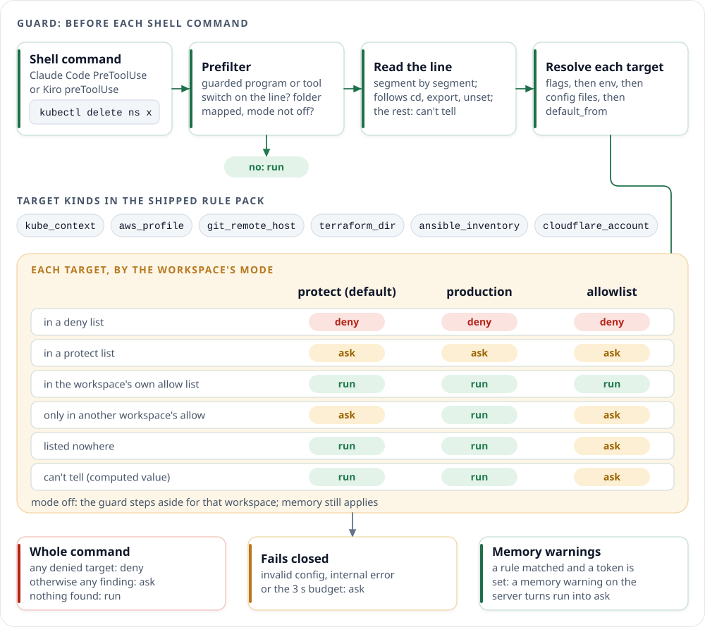
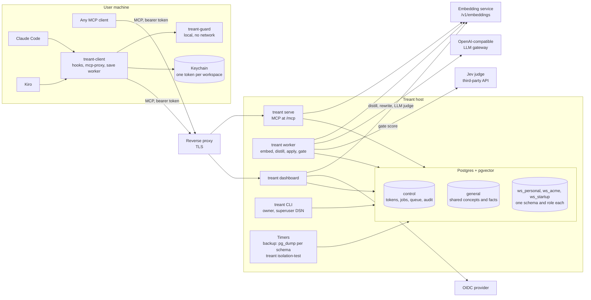
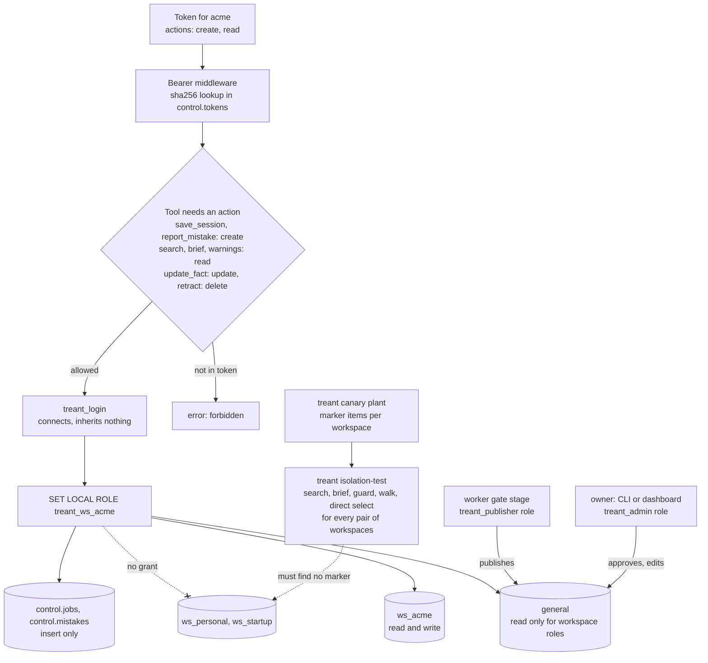
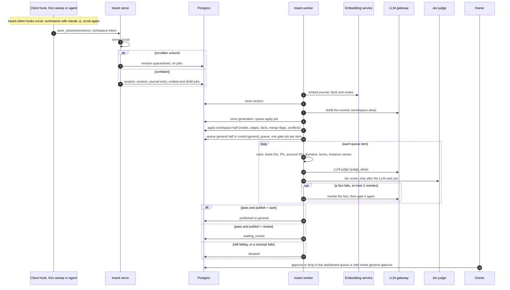
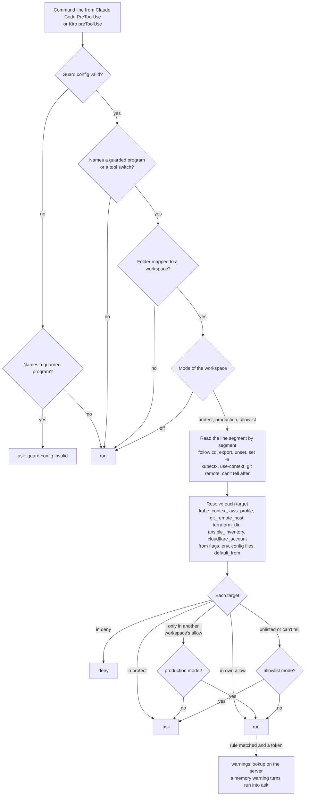

# Architecture

This document describes how Treant is built: the processes, the database layout, how
workspaces are kept apart, what happens to a save, the gate in front of `general`, the guard,
the isolation test and the dashboard. The README's "How it works" section gives the overview
with the same diagrams; this page has the detail. Text (Mermaid) versions of the diagrams are
at the end, under [Diagram sources](#diagram-sources). For running it in production see
[deploy.md](deploy.md).

## Components

| Component | Command or package | Role |
|---|---|---|
| MCP server | `treant serve` | Streamable HTTP at `/mcp` behind a bearer-token middleware, `/healthz` without auth. Stores saves, answers search, brief and warnings. Embeds search queries. |
| Worker | `treant worker` | Runs the job stages `embed`, `distill`, `apply`, `gate`, plus embedding of `general`. The only process that calls models. |
| Dashboard | `treant dashboard` | Owner web UI (Starlette, server-rendered, no JavaScript). |
| Owner CLI | `treant <command>` | Bootstrap, upgrade, workspaces, tokens, queue decisions, jobs, canaries, isolation test. Uses the Postgres superuser DSN for commands that create roles or schemas. |
| Client | `treant-client` (`client/`) | Claude Code and Kiro hooks, a stdio MCP proxy that picks the workspace token from the folder, a detached save worker. Standard library only. |
| Guard | `treant-guard` (`guard/`) | Local decision on risky shell commands. Standard library only, no network. |

External services:

- an embedding service with an OpenAI-compatible `/v1/embeddings` serving EmbeddingGemma 300M
  (768 dimensions; the vector columns are `vector(768)` and the embedder sends EmbeddingGemma's
  prompt prefixes, so the model is fixed);
- an OpenAI-compatible chat endpoint (`TREANT_LITELLM_URL`) for distillation, rewrites and the
  LLM judge, with one key per workspace (`TREANT_LITELLM_KEY_<WS>`);
- the Jev judge, a third-party scoring API (`TREANT_JEV_URL`, default
  `https://api.typesafe.ai`, key `TREANT_JEV_API_KEY`), required for automatic publishing to
  `general`; `TREANT_JEV=off` turns it off and sends every pass to the owner's review;
- an OIDC provider for the dashboard login (unless `TREANT_DASHBOARD_AUTH=none`).

<picture>
  <source media="(prefers-color-scheme: dark)" srcset="assets/architecture-dark.svg">
  
</picture>

## Database layout

One Postgres database with the `vector` extension and three kinds of schema:

| Schema | Holds |
|---|---|
| `control` | `workspaces` (with per-workspace `settings` as JSON), `tokens`, `jobs`, `audit`, `mistakes`, `canaries`, `metrics`, `general_queue`, `general_session_head`, `general_origin` |
| `general` | shared `nodes`, `edges`, `facts`, `versions`, `embeddings` |
| `ws_<name>` | one per workspace: `sessions`, `revisions`, `journal_entries`, `nodes`, `edges`, `facts`, `support`, `versions`, `embeddings`, `generations`, `merge_flags`, `conflicts`, `targets` (deprecated) |

Workspace names match `[a-z][a-z0-9]{1,30}`; `general` and `control` are reserved. Every
identifier that reaches SQL is derived from a validated name (`src/treant/names.py`).

### Roles

`treant bootstrap` creates these roles (prefix `TREANT_ROLE_PREFIX`, default `treant`), all
without superuser, createdb, createrole, replication or bypassrls:

| Role | Can |
|---|---|
| `<prefix>_login` | Log in. Member of the roles below with `INHERIT FALSE, SET TRUE`: it holds no privileges of its own and must switch role. |
| `<prefix>_control` | Read and write `control` (tokens, jobs, audit). |
| `<prefix>_publisher` | Write `general`, `control.general_queue` and `general_origin`, queue jobs. Used by the apply stage for the general half and by the gate to publish. |
| `<prefix>_gate` | Read each workspace's instance names (a view), for the gate rules. |
| `<prefix>_admin` | Owns the objects; owner actions (approve, edit, restore, purge). |
| `<prefix>_ws_<name>` | One per workspace: read and write its own `ws_<name>`, read `general`, insert into `control.jobs` and `control.mistakes`. Nothing else. |

The application connects as the login role and runs every transaction under
`SET LOCAL ROLE <role>`. A workspace transaction (`Database.ws_tx`) therefore cannot see
another workspace's schema even if the code asked for it: the role has no grant. Search adds a
second check and drops any hit whose source schema is not the token's.

### Tokens and action scopes

A token has the form `trt_<id>_<secret>`. Only `sha256(secret)` is stored, in
`control.tokens`, with the workspace and a set of actions:

| Action | Tools |
|---|---|
| `create` | `save_session`, `report_mistake` |
| `read` | `search`, `brief`, `warnings`, `guard_check` (deprecated) |
| `update` | `update_fact` |
| `delete` | `retract` |

The middleware answers a missing or unknown token with a bare `401` and no OAuth challenge.
A tool whose action the token lacks returns `{"error": "forbidden"}`. Errors never carry
exception text.

<picture>
  <source media="(prefers-color-scheme: dark)" srcset="assets/isolation-dark.svg">
  
</picture>

## Saving

<picture>
  <source media="(prefers-color-scheme: dark)" srcset="assets/pipeline-dark.svg">
  
</picture>

`save_session(client_session_id, sections, unsure)` takes typed sections (`journal`, `facts`,
`decisions`, `lessons`, `dead_ends`, `procedures`, `changes`, `open_threads`, `preferences`,
`warnings`, `client_memory`). In one workspace transaction the server:

1. scrubs every section (secrets, keys, tokens, IP addresses, account numbers, private host
   names and the workspace's configured terms become `[removed]`);
2. stores the session, a new revision and a journal entry;
3. queues an `embed` job and a `distill` job for the revision.

When the client marked the save `unsure`, or the server scrubber is not confident, the revision
is quarantined instead: stored, but with no jobs, so nothing of it is searchable until the
owner releases it (`treant quarantine release`) or drops it.

Saves are additive. A session is usually saved several times; every stored revision is
distilled and applied, and what earlier revisions produced stays current. The one exception is
open threads: the session's newest revision carries the current list, and open threads that
only older revisions support are superseded.

The client side (`treant-client`) summarizes a finished Claude Code or Kiro session with
`claude -p`, scrubs before and after summarizing, and skips short sessions.

## Jobs and the worker

Jobs live in `control.jobs` (kind, key, payload, attempts, status). The worker loop runs one
job per stage per iteration and sleeps only when no stage found work. A stage error is logged
by type name and the loop continues.

Failure categories and attempt caps:

| Category | Meaning | Attempts |
|---|---|---|
| `model_unavailable` | model service down, timed out or 429/5xx | distill 12, gate 20 |
| `model_rejected` | a 4xx such as a bad key | distill 12, gate 20 |
| `model_bad_reply` | the distill model answered with no JSON object | 3 |
| `judge_unavailable` | Jev or the LLM judge down, or Jev on without a key | 20 |
| `judge_rejected` | a judge refused the request (4xx) | 3 |
| `judge_bad_reply` | the LLM judge's reply held no usable verdict | 3 |
| `settings_invalid` | a workspace settings row does not parse | 20 |
| `embedder`, `internal` | embedder down; anything else | embed 8, distill and apply 12, gate 20 |

A job that runs out of attempts is `dead`; `treant jobs retry --status dead` replays it after
the cause is fixed.

### Distill

The workspace's model (alias `alias`, default `default`) turns the saved sections into a
*generation*: workspace nodes, edges and facts, plus a general half of concepts and facts.
Invalid items are dropped one by one and the counts are kept in `stats`. A reply that is not a
JSON object stores nothing and fails the job. A workspace with `backend = "none"` is never sent
to a model: its revisions stay journal-only.

### Apply

One workspace transaction resolves nodes by exact name or alias (a near match creates a new
node plus a `merge_flags` row for the owner), matches facts by type, node and text similarity
(a changed text becomes a new version), and records a `conflicts` row when the model says a
fact supersedes another. A second transaction, as the publisher role, queues the general half
in `control.general_queue` with one `gate` job per new item. A fact is not queued again when
the same text is already published or waiting, or is a close rephrasing of one the same session
queued before.

## The gate

`general` is readable by every workspace, so nothing reaches it without passing the gate:

1. **Rules** (`gate_rules.py`): ticket IDs, IP addresses, 12-digit account IDs, the workspace's
   configured domains, ticket prefixes and terms, private host names, and the instance names of
   every workspace (archived ones included).
2. **LLM judge** (workspace `judge_alias`), asked with the question for the item's kind from
   `criteria.toml`.
3. **Jev**, asked only after the LLM judge said yes. A pass needs both: the LLM's yes and a Jev
   score at or above the threshold in `criteria.toml`. With `TREANT_JEV=off` Jev is skipped and
   the LLM's yes only sends the item to `waiting_review`; it is never published automatically.

A failing fact is rewritten by the workspace's model and gated again, at most twice, then
`blocked`. A concept is never rewritten; a failing concept is `blocked`. A concept that already
exists in `general` is reused without judging. A judge that is down makes the job wait and
retry; the gate never passes an item on one judge.

A pass publishes the item (workspace setting `publish = auto`, the default) or holds it as
`waiting_review` (`publish = review`). The owner approves or drops `pending`, `waiting_review`
and `blocked` items in the dashboard or with `treant general approve|drop`; an approval runs the
rules again on the final text and refuses on a finding unless forced, and is always audited.

Reasons stored on queue items name only a category and a character span, never the text.
Where a general item came from (`control.general_origin`) is readable only by the owner.

## Search and brief

`search` embeds the query and ranks by cosine similarity over the workspace's and `general`'s
vectors (facts and nodes in both, journal entries in the workspace only), then adds facts reached by a one-hop graph walk from the
matched nodes. Everything runs in one workspace transaction. Each `embeddings` table has one
partial HNSW index per item kind (`embeddings_fact_vec_idx`, `embeddings_node_vec_idx` and, in
workspace schemas, `embeddings_journal_vec_idx`), and search scans each one for its nearest
vectors with `hnsw.ef_search` set to 100 for its transaction. Vectors exist only for current
items: a trigger drops an item's vector when it stops being current.

`brief` returns a short text for the start of a session: warnings, open threads and, when a
repository is named, what memory holds about it (capped at 6000 characters). With
`repo_only` it returns only the repository section.

`warnings` returns the current warning facts on the workspace's own nodes whose name or alias
matches one of the given words.
The client guard uses it to add memory warnings to a decision.

## Guard

<picture>
  <source media="(prefers-color-scheme: dark)" srcset="assets/guard-dark.svg">
  
</picture>

The guard runs on the client, in the hook, before a shell command runs. It needs no server.
It loads rules (the shipped pack plus the user's `~/.config/treant/guard.toml` and
`guard.d/*.toml`), maps the session folder to a workspace, reads the command line segment by
segment (following `cd`, `export` and similar state changes where it can, and treating the rest
as "can't tell"), resolves the target of each matched rule (kube context, AWS profile, git remote
host, Terraform folder, Ansible inventory, Cloudflare account), and compares it with the
workspace's `allow`, `deny` and `protect` lists and the mode (`protect`, `production`,
`allowlist`, `off`). The result is run, ask or deny; it fails closed (asks) on an invalid
config, an internal error or a timeout. Only then, when a rule matched and the workspace has a
token, the client asks the server for `warnings`, and a warning turns a run into an ask.

The full rule language, modes and known gaps are in [guard/README.md](../guard/README.md). The
server-side `target` commands and the `guard_check` tool are deprecated and kept for older
clients.

## Canaries and the isolation test

`treant canary plant <ws>` writes marker items into a workspace: an instance node, a warning
fact on it and a fact carrying a random marker. `treant isolation-test` then tries, as every
active workspace in turn, to reach every other workspace's markers through each read path:
`search`, `brief`, `guard`, the graph walk, and a direct `SELECT` on the other schema with the
workspace's role. It also checks that no marker sits in `general` or in a published queue item.
It exits 0 when clean and 1 on any fault, and plants nothing itself. Run it on a schedule
against the live database (see [deploy.md](deploy.md)).

## Dashboard

`treant dashboard` serves the owner pages: review queue, quarantine, jobs, workspaces
(settings, archive), tokens (created on a `no-store` page, shown once), memory (browse, search,
edit, history and restore, duplicates, merges, conflicts, sessions, a server-rendered SVG graph
view), mistakes, measurements and the audit log. Every action writes `control.audit` with actor
`dashboard:<user>`.

Login is OIDC (authorization code with PKCE) by default: the user must be in
`TREANT_DASHBOARD_OWNERS` and in the group `TREANT_DASHBOARD_GROUP`. Sessions are signed cookies
with an 8 hour absolute lifetime and no provider tokens inside. Sensitive actions (approving,
forced edits, releasing quarantine, workspace settings, tokens) need a login younger than
`TREANT_DASHBOARD_REAUTH_S` seconds; an older one is sent back to the provider with
`prompt=login` and `max_age=0`, and the dashboard checks the new `auth_time` (fail closed).
With `TREANT_DASHBOARD_AUTH=none` there is no login and every request acts as the single
owner; use it only on a trusted network.

The pages use Tailwind CSS and daisyUI compiled into `src/treant/dashboard/static/app.css`
(source `css/app.css`, build with `scripts/build-css.sh`), with no JavaScript, so the Content
Security Policy stays `default-src 'self'`.

## Workspace settings

`treant workspace set <ws>` (or the dashboard) edits `control.workspaces.settings`:

| Key | Values | Default |
|---|---|---|
| `backend` | `litellm`, or `none` (journal only, nothing sent to any model) | `litellm` |
| `alias`, `judge_alias` | model names sent to the chat endpoint | `default` |
| `publish` | `auto` or `review` | `auto` |
| `rules.domains`, `rules.ticket_prefixes`, `rules.terms` | the gate's deny lists (terms also feed the server scrubber; 3 or more characters, at most 200 each) | empty |

A settings row that does not parse quarantines that workspace's saves and holds its gate jobs
(`settings_invalid`) until it is fixed.

## Diagram sources

Text versions of the four diagrams above, checked against the code. The SVGs in
`docs/assets/` (light and `-dark` variants) are drawn from the same boxes and arrows; when one
changes, change the other.

### System overview

### Workspace isolation

### Save and distillation

### Guard decision

Any denied target makes the whole command `deny`; otherwise any finding makes it `ask`. An
internal error or the 3 second budget running out also asks (fail closed).
